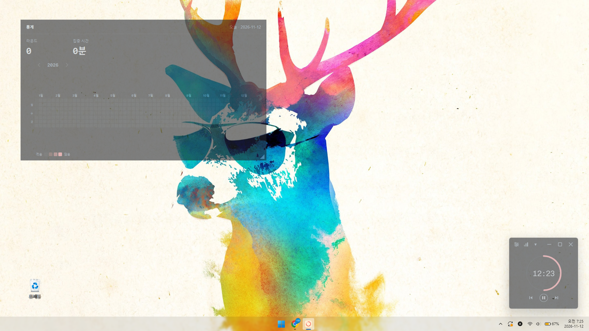
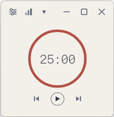
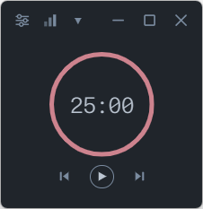
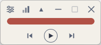
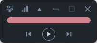

# ClearPomo (클리어포모)

집중과 휴식을 번갈아 진행하고, 집중 기록을 바탕화면에서 확인할 수 있는 Windows용 뽀모도로 타이머입니다.

*Windows 바탕화면에 띄운 반투명 타이머와 통계 위젯*

## 주요 기능

- **불투명도 조절** — 타이머와 통계 위젯의 불투명도를 각각 20~100%로 조절할 수 있습니다.
- **마우스를 올리면 부드럽게 전환** — 타이머에 포인터를 올리면 따로 지정한 불투명도로 부드럽게 바뀝니다. 포인터가 창을 벗어나면 평상시 값으로 돌아옵니다.
- **가로 미니 모드** — 원형 타이머를 작은 가로 진행 바로 바꿔 화면 공간을 아낄 수 있습니다. 모드를 바꿔도 진행 중인 라운드는 이어집니다.
- **바탕화면 통계 위젯** — 오늘 완료한 집중 라운드 수와 집중 시간을 보여 주고, 연간 집중 기록을 잔디로 표시합니다. 위젯은 바탕화면에서 옮기거나 크기를 조절할 수 있습니다.

### 타이머 화면

| 밝은 테마 | 어두운 테마 |
| :---: | :---: |
|  |  |
|  |  |

## Windows 설치 및 기본 사용법

### 설치

[Windows x64 다운로드](https://github.com/gc757577/pomotroid/releases/tag/v0.1.0-rc.5)

1. Windows x64용 설치 파일(`ClearPomo_*_x64-setup.exe`)을 실행하고 설치 화면의 안내를 따릅니다.
2. 설치가 끝나면 시작 메뉴에서 **ClearPomo**를 엽니다.

기존 Preview의 기록을 백업하고 덮어쓰는 방법은 [Windows 업데이트 절차](./RELEASE-CLEARPOMO.md)에 있습니다. 소스에서 실행하려면 [Windows 개발 실행 안내](./DEVELOPMENT-WINDOWS.md)를 참고하세요.

### 기본 사용법

1. 타이머의 **▶** 버튼을 눌러 집중 라운드를 시작합니다. 같은 버튼으로 일시정지하거나 재개할 수 있습니다. 집중 시간, 휴식 시간, 긴 휴식까지의 라운드 수는 **설정 → 타이머**에서 바꿀 수 있습니다.
2. 상단의 ▼를 누르면 가로 미니 모드로 바뀌고, ▲를 누르면 원형 타이머로 돌아갑니다.
3. **설정 → 화면 → 바탕화면 통계 위젯**을 켭니다. 같은 화면에서 타이머의 평상시·마우스를 올렸을 때의 불투명도와 위젯 불투명도를 조절할 수 있습니다.
4. 앱을 완전히 종료하려면 Windows 작업 표시줄의 알림 영역에서 **ClearPomo** 아이콘을 오른쪽 클릭하고 **종료**를 선택합니다. 아이콘이 숨겨져 있으면 ∧를 눌러 찾을 수 있습니다.

## 출처와 라이선스

ClearPomo는 Christopher Murphy의 뽀모도로 타이머 [Pomotroid](https://github.com/Splode/pomotroid)를 기반으로 합니다. 원본 저작권은 © 2018 Christopher Murphy이며, 소스 코드는 [MIT 라이선스](./LICENSE)로 배포됩니다.
